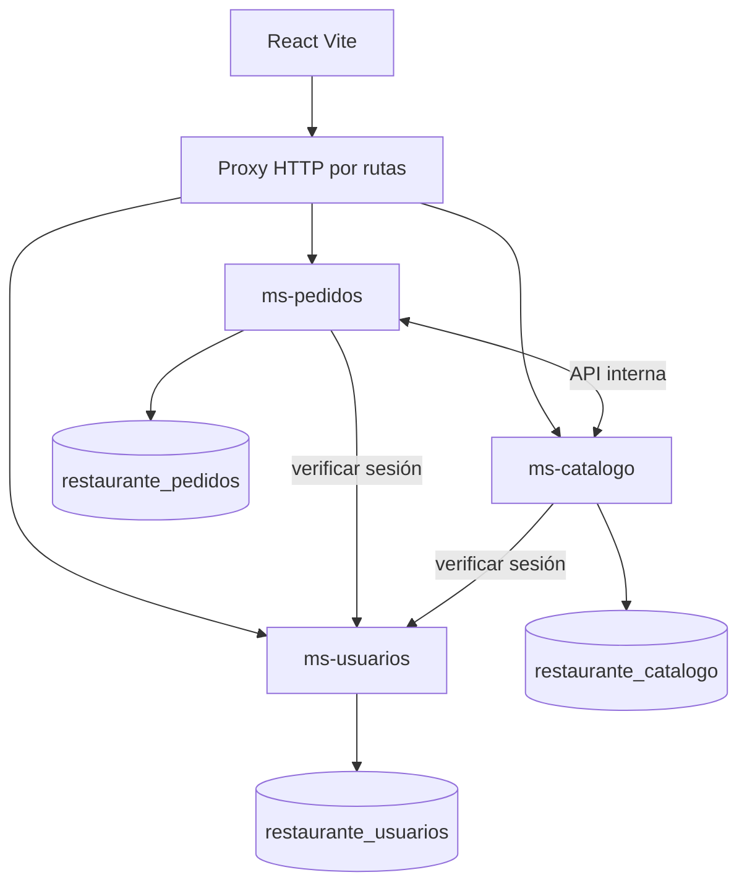

# 03 — Patrones y decisiones de arquitectura

## Bounded contexts (3, no más)
- **ms-usuarios**: propietario exclusivo de `restaurante_usuarios.usuarios`. Login, logout, roles y CRUD básico del personal.
- **ms-catalogo**: propietario exclusivo de `restaurante_catalogo.productos` y `mesas`. Listados y CRUD.
- **ms-pedidos**: propietario exclusivo de `restaurante_pedidos.pedidos` y `detalle_pedido`. Totales, snapshots, transiciones y reglas de mesas activas.

## 1. Repository / Data Mapper sencillo
**Aplicación:** consultas SQL con `mysql2/promise` en cada servicio (versión del kit todavía concentra consultas en `server.mjs`; separar más adelante si crece).  
**Por qué:** aislar acceso SQL sin añadir ORM pesado.  
**Regla:** ms-pedidos no consulta tablas de catálogo ni usuarios directamente; cada servicio recibe solo los privilegios de su BD.

## 2. State / máquina de estados
**Aplicación:** `services/shared/domain.mjs` y PATCH `/api/pedidos/:id/estado`.  
**Por qué:** las transiciones son exactamente cuatro estados y tres roles, sin excepciones.  
**Contrato:** Cocinero `Pendiente -> En preparación -> Listo`, Mesero/Administrador `Listo -> Entregado`; cambios atómicos dentro de transacción.

## 3. DTO + Validation Schema (Zod)
**Aplicación:** entrada en cada endpoint (número de mesa, precios, cantidades, nombre, contraseña y estados).  
**Por qué:** el frontend nunca es fuente confiable.  
**Contrato:** 422 para valores inválidos y 403 para rol sin permiso.

## 4. Adapter
**Aplicación:** `frontend-integration/apiClient.ts` traduce formularios y vistas React al contrato HTTP, usando `credentials:'same-origin'`.  
**Por qué:** evita reescribir UI; también evita almacenar contraseñas o sesiones en `localStorage`.  
**Pendiente:** conectar los componentes existentes y sustituir métodos síncronos del `RestaurantContext` por `async/await`.

## 5. API Gateway ligero por enrutamiento HTTP
**Aplicación:** proxy de Vite en desarrollo; proxy inverso HTTPS del hosting en producción.  
**Por qué:** un único origen web y rutas `/api/*`, sin añadir un cuarto proceso empresarial.
- `/api/auth`, `/api/usuarios` -> ms-usuarios
- `/api/productos`, `/api/mesas` -> ms-catalogo
- `/api/pedidos` -> ms-pedidos

## 6. Transaction Script + control de concurrencia
**Aplicación:** `ms-pedidos` guarda cabecera y detalles en una transacción SQL local. MySQL index `uq_mesa_activa` evita dos pedidos activos para una mesa.  
**Integridad entre microservicios:** un candado MySQL de nombre `gb:table:<id>` / `gb:product:<id>` protege el intervalo de validación con HTTP hasta el commit y la eliminación correspondiente. Requiere que los tres servicios compartan la misma instancia MySQL aprobada; cada uno sigue accediendo solo a su esquema.  
**Por qué:** el SRS exige integridad histórica sin transacciones distribuidas complejas.  
**Límite:** si otros procesos escriben directamente en MySQL ignorando estos candados, NO hay garantía de integridad lógica entre esquemas; restringir acceso DB y centralizar operaciones en APIs.

## 7. No usar patrones por moda
Se descartan CQRS, Observer, Event-Driven, Saga, Factory genérica y múltiples gateways: para 18 RF y cuatro semanas agregarían colas, eventos, más pruebas y más puntos de error sin mejorar el flujo principal.

## Diagrama lógico (Mermaid)

## Seguridad
- Sesión revocable hash SHA-256 de token aleatorio, cookie `HttpOnly`, `SameSite=Lax`, `Secure` en HTTPS.
- Solo el servicio de Usuarios verifica contraseña bcrypt; rol validado también en backend.
- `INTERNAL_SERVICE_KEY` confidencial (mínimo 32 caracteres) para endpoints internos. No exponerlos mediante el proxy público.
- Para producción revisar protección CSRF, límites de solicitudes de login y cabeceras HTTP antes de publicar. Estas medidas necesitan prueba de seguridad en la configuración definitiva.
