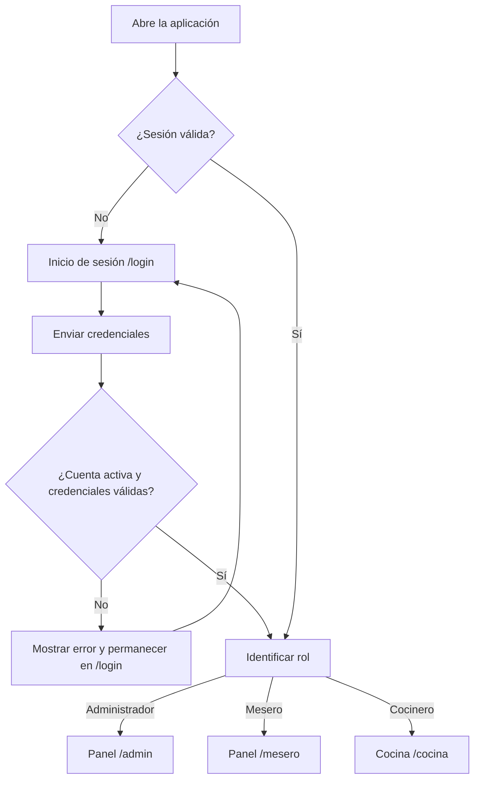
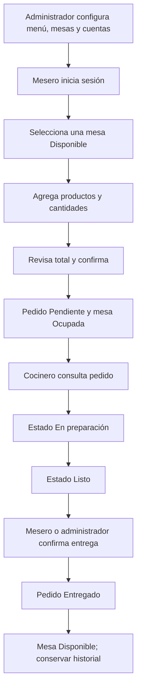
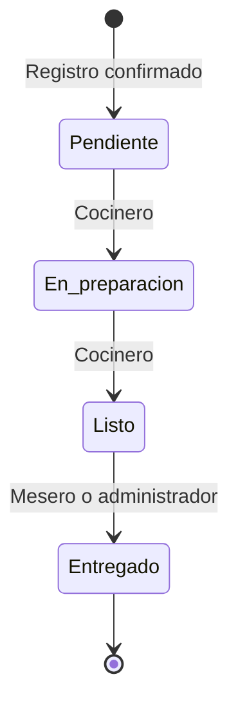
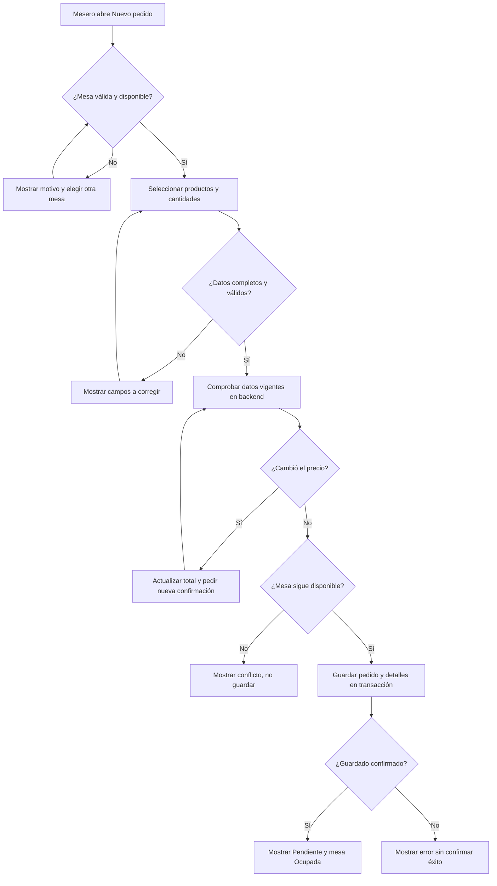

# USER FLOW — Flujo de navegación

## Sistema de pedidos para restaurante

| Control documental | Información |
|---|---|
| **Documento** | User Flow — Especificación de navegación e interacción |
| **Proyecto** | Sistema de pedidos para restaurante |
| **Versión** | 1.0 |
| **Fecha** | 10 de noviembre de 2026 |
| **Estado** | Consolidado a partir de las cinco fases del USER FLOW aprobadas en la entrevista |
| **Ámbito** | Aplicación web interna y responsive para un único restaurante |
| **Plazo del proyecto** | Cuatro semanas, Scrum simplificado |
| **Documentos de referencia** | `PRD_Sistema_Pedidos_Restaurante.md`, `TRD_Sistema_Pedidos_Restaurante.md` y `PLAN_Sistema_Pedidos_Restaurante.md` |
| **Única decisión abierta** | **Plataforma de alojamiento definitivo: pendiente de definir** |

> **Límite de alcance.** El flujo se restringe al menú, los pedidos, la cocina, la administración básica y el acceso de personal autorizado. No contempla clientes con cuenta, pagos, facturación, reservas, domicilios, inventario de ingredientes, cancelación de pedidos registrados ni funciones de tiempo real. Este documento describe el **comportamiento esperado** de la aplicación; no afirma que sus pantallas o funcionalidades ya estén implementadas.

---

## Tabla de contenido

1. [Propósito, alcance y referencias](#1-propósito-alcance-y-referencias)
2. [Actores, roles y permisos de navegación](#2-actores-roles-y-permisos-de-navegación)
3. [Mapa de pantallas y rutas](#3-mapa-de-pantallas-y-rutas)
4. [Fase 1 — Punto de partida y estado inicial](#4-fase-1--punto-de-partida-y-estado-inicial)
5. [Fase 2 — Camino crítico (Happy Path)](#5-fase-2--camino-crítico-happy-path)
6. [Flujos específicos por rol](#6-flujos-específicos-por-rol)
7. [Estados y transiciones de pedido y mesa](#7-estados-y-transiciones-de-pedido-y-mesa)
8. [Fase 3 — Escenarios alternativos y bifurcaciones](#8-fase-3--escenarios-alternativos-y-bifurcaciones)
9. [Errores técnicos y continuidad de la navegación](#9-errores-técnicos-y-continuidad-de-la-navegación)
10. [Fase 4 — Estados visuales de carga, vacío y error](#10-fase-4--estados-visuales-de-carga-vacío-y-error)
11. [Fase 5 — Confirmaciones, puntos de salida y retorno](#11-fase-5--confirmaciones-puntos-de-salida-y-retorno)
12. [Catálogo de reglas de navegación NAV-01 a NAV-26](#12-catálogo-de-reglas-de-navegación-nav-01-a-nav-26)
13. [Catálogo de reglas de interfaz UI-01 a UI-10](#13-catálogo-de-reglas-de-interfaz-ui-01-a-ui-10)
14. [Comunicación con la API y consistencia de datos](#14-comunicación-con-la-api-y-consistencia-de-datos)
15. [Diseño responsive y accesibilidad de la interacción](#15-diseño-responsive-y-accesibilidad-de-la-interacción)
16. [Trazabilidad y criterios de aceptación](#16-trazabilidad-y-criterios-de-aceptación)
17. [Pruebas y evidencias del flujo](#17-pruebas-y-evidencias-del-flujo)
18. [Restricciones, decisión pendiente y control de cambios](#18-restricciones-decisión-pendiente-y-control-de-cambios)
19. [Criterios de cierre del documento](#19-criterios-de-cierre-del-documento)

---

## 1. Propósito, alcance y referencias

### 1.1. Propósito

Definir de manera verificable **qué pantalla visualiza cada rol, qué pasos ejecuta, qué decide el sistema, qué ocurre ante una excepción y dónde continúa el usuario** cuando una operación termina. Esta especificación sirve como base para diseñar prototipos, implementar la navegación en React, aplicar las validaciones de Node.js y ejecutar pruebas funcionales y de integración.

### 1.2. Alcance funcional

- **Cuatro módulos de negocio:** menú, pedidos, cocina y administración.
- **Tres actores autenticados:** administrador, mesero y cocinero.
- **Autenticación transversal:** pantalla de acceso, sesiones revocables, rutas protegidas y cierre de sesión.
- **Recorrido principal:** configuración inicial → registro del pedido → preparación → entrega → mesa disponible.
- **Dos estados de acceso:** sin sesión válida y con sesión válida.
- **Cuatro estados del pedido:** Pendiente, En preparación, Listo y Entregado.
- **Dos estados derivados de la mesa:** Disponible y Ocupada.

Todos los flujos se corresponden con los **18 requisitos funcionales** y **12 requisitos no funcionales** del PRD. No se autoriza ampliar el alcance por implementar el USER FLOW.

### 1.3. Correspondencia con el stack y la arquitectura

| Componente | Decisión aprobada | Relevancia para el flujo |
|---|---|---|
| Frontend | React + Vite + CSS | Renderiza rutas, formularios, listados y estados de interfaz. |
| Backend | Node.js + Express | Responde a solicitudes REST y aplica reglas de negocio. |
| Servicios | Usuarios; Catálogo y mesas; Pedidos y cocina | Atienden las acciones desde las pantallas. |
| Persistencia | MySQL, tres bases de datos lógicas, cinco tablas principales | Conserva registros, detalles, estados e historial. |
| Autenticación | Sesiones revocables mediante token aleatorio, cookie `HttpOnly`, rol verificado por backend | Determina acceso y redirección. |
| Validaciones | Zod en backend; comprobaciones sencillas en React | Impide enviar o guardar datos inválidos. |
| Comunicación | HTTP y JSON; sin WebSockets | Las vistas se actualizan mediante consultas normales. |
| Alojamiento final | **Pendiente de definir** | No cambia las rutas ni los flujos aprobados. |

## 2. Actores, roles y permisos de navegación

### 2.1. Actores y objetivos

| Actor | Objetivo principal | Pantalla inicial autenticada |
|---|---|---|
| **Administrador** | Configurar menú, mesas y cuentas; supervisar y registrar pedidos y confirmar entregas. | `/admin` |
| **Mesero** | Consultar mesas y menú; registrar y seguir pedidos; confirmar entregas. | `/mesero` |
| **Cocinero** | Consultar pedidos y avanzar los estados de preparación. | `/cocina` |
| **No autenticado** | Ingresar credenciales válidas. | `/login` |

Los clientes del restaurante son beneficiarios indirectos; **no tienen cuenta, pantalla ni permisos** dentro del sistema.

### 2.2. Matriz consolidada de permisos

| Acción | Administrador | Mesero | Cocinero |
|---|:---:|:---:|:---:|
| Iniciar/cerrar sesión | Sí | Sí | Sí |
| Consultar menú | Sí | Sí | Sí |
| Crear, editar, eliminar productos permitidos y cambiar disponibilidad | Sí | No | No |
| Registrar, modificar o eliminar mesas permitidas | Sí | No | No |
| Consultar mesas/disponibilidad | Sí | Sí | No |
| Registrar pedido | Sí | Sí | No |
| Consultar pedido y detalles | Sí | Sí | Sí |
| Pasar Pendiente → En preparación → Listo | No | No | Sí |
| Confirmar Listo → Entregado | Sí | Sí | No |
| Crear, consultar, modificar y desactivar usuarios | Sí | No | No |

**Autoridad:** ocultar botones en React facilita la navegación, pero **no sustituye** la verificación de autenticación y permisos que debe realizar el backend en cada endpoint protegido.

## 3. Mapa de pantallas y rutas

### 3.1. Rutas públicas y protegidas aprobadas

| Ruta del frontend | Vista/propósito | Rol autorizado | Acciones principales |
|---|---|---|---|
| `/login` | Acceso del personal | Sin sesión válida | Introducir usuario y contraseña; iniciar sesión. |
| `/admin` | Panel de administración | Administrador | Acceder a menú, mesas, cuentas y operaciones permitidas de pedidos. |
| `/admin/productos` | Lista y formularios de productos | Administrador | CRUD permitido y disponibilidad. |
| `/admin/mesas` | Lista y formularios de mesas | Administrador | CRUD permitido; consultar disponibilidad. |
| `/admin/usuarios` | Lista y formularios de usuarios | Administrador | Crear, consultar, modificar, asignar rol y desactivar cuentas. |
| `/mesero` | Panel de mesas y pedidos | Mesero | Ver mesas y acceder a pedidos. |
| `/mesero/nuevo-pedido` | Registro de pedido | Mesero | Elegir mesa, agregar productos y cantidades, confirmar. |
| `/mesero/pedidos` | Listado y consulta de pedidos | Mesero | Consultar estado y marcar pedidos Listos como Entregados. |
| `/cocina` | Pedidos y preparación | Cocinero | Consultar pedidos y avanzar la preparación. |

**Reutilización aprobada:** el administrador también puede registrar y consultar pedidos y confirmar entregas **desde su panel**, reutilizando los componentes y acciones de pedidos sin obligar a crear nuevas rutas públicas ni duplicar lógica. Las rutas anteriores son la base de navegación; no impiden reutilizar un componente en varias vistas autorizadas.

### 3.2. Mapa general de entrada



### 3.3. Condiciones de acceso a las vistas

- **Sesión sin verificar:** mostrar carga; nunca exhibir brevemente contenido protegido.
- **Sin sesión válida:** mostrar `/login`.
- **Sesión válida, ruta de otro rol:** negar la navegación y dirigir al panel propio.
- **Sesión expirada o revocada:** invalidar acceso y volver a `/login`.
- **Ruta permitida:** mostrar la información según las operaciones autorizadas.
- **Recarga del navegador:** validar nuevamente la sesión sin exigir credenciales si todavía está vigente.

## 4. Fase 1 — Punto de partida y estado inicial

### 4.1. Entrada por primera vez

El empleado llega mediante la dirección web de la aplicación. Como **no existe landing page ni registro público**, se presenta el formulario de acceso cuando no hay sesión válida.

**Elementos de `/login`:** nombre del sistema, campo **nombre de usuario**, campo **contraseña**, botón **Iniciar sesión**, indicador de procesamiento y mensajes de validación o error. No se incluyen redes sociales, creación de cuenta ni recuperación de contraseña por correo.

La primera cuenta del administrador se aprovisionará mediante el procedimiento técnico controlado definido en el TRD; las cuentas del personal las crea el administrador.

### 4.2. Proceso de inicio de sesión

1. React consulta si existe una sesión válida mediante la API de usuarios.
2. Si no existe, presenta el formulario `/login`.
3. El usuario escribe nombre de usuario y contraseña.
4. React valida los campos obligatorios y envía la solicitud de autenticación.
5. El servicio de Usuarios comprueba credenciales, hash bcrypt y estado activo.
6. Si son válidas, crea una sesión revocable y devuelve la confirmación correspondiente.
7. React consulta o recibe el rol autenticado y redirige a `/admin`, `/mesero` o `/cocina`.
8. Si falla, permanece en `/login` con un mensaje comprensible, sin exponer detalles sensibles.

La sesión utiliza token aleatorio enviado en cookie `HttpOnly`, cuya validez comprueba el backend; los servicios protegidos validan la sesión y el rol ante Usuarios. El modelo aprobado permite **una sesión activa por cuenta**.

### 4.3. Diferencia entre anónimo y autenticado

| Situación | Lo que puede visualizar y realizar |
|---|---|
| No autenticado | Formulario `/login` y errores de ingreso; sin menú, mesas, pedidos, cocina ni administración. |
| Administrador autenticado | Administración de productos, mesas y cuentas; consulta y registro de pedidos; confirmación de entrega. |
| Mesero autenticado | Consulta de menú y mesas; registro, seguimiento y entrega de pedidos. |
| Cocinero autenticado | Consulta de menú y pedidos, actualización de preparación; sin gestión de mesas/usuarios. |

## 5. Fase 2 — Camino crítico (Happy Path)

### 5.1. Precondiciones

- Las bases de datos y tres microservicios están operativos.
- Existe al menos una cuenta administradora activa y cuentas válidas de mesero y cocinero.
- Hay al menos una mesa registrada y Disponible y productos disponibles en el menú.
- La comunicación entre servicios y la autenticación funcionan.

### 5.2. Flujo principal de extremo a extremo

| Paso | Actor | Acción visible | Verificación del sistema | Resultado/continuación |
|---|---|---|---|---|
| HP-P01 | Administrador | Inicia sesión y abre `/admin`. | Credenciales, cuenta activa, rol. | Panel autorizado. |
| HP-P02 | Administrador | Registra productos con sus precios. | Nombre, precio positivo; persistencia en Catálogo. | Menú disponible. |
| HP-P03 | Administrador | Registra mesas. | Número único y positivo. | Mesas inicialmente disponibles. |
| HP-P04 | Administrador | Crea cuentas de mesero y cocinero. | Nombre único, contraseña protegida, rol válido. | Personal habilitado. |
| HP-P05 | Mesero | Inicia sesión, elige Nuevo pedido y una mesa Disponible. | Rol y disponibilidad de la mesa. | Formulario listo. |
| HP-P06 | Mesero | Selecciona uno o más productos disponibles, indica cantidades y revisa el total. | Existencia, disponibilidad, enteros positivos y precio vigente. | Resumen del pedido. |
| HP-P07 | Mesero | Confirma el pedido. | El backend recalcula, valida y guarda pedido+detalles de forma atómica. | Pedido **Pendiente**, mesa **Ocupada**; confirmación visible. |
| HP-P08 | Cocinero | Abre `/cocina`, consulta el pedido y lo pasa a En preparación. | Sesión, rol y transición válida. | Pedido **En preparación**. |
| HP-P09 | Cocinero | Finaliza preparación. | Transición En preparación → Listo. | Pedido **Listo**. |
| HP-P10 | Mesero | Consulta el pedido Listo y confirma entrega. | Rol y estado persistido Listo. | Pedido **Entregado**, mesa **Disponible**, historial conservado. |

> **Resultado central:** un pedido queda registrado y conservado en MySQL desde el estado **Pendiente** hasta **Entregado**; la mesa retorna a **Disponible** porque ya no existe un pedido activo. No intervienen pagos ni facturación.

### 5.3. Diagrama del flujo operativo



### 5.4. Criterios HP-01 a HP-10 aprobados

| ID | Condición verificable |
|---|---|
| HP-01 | Administrador puede preparar menú, mesas y usuarios. |
| HP-02 | Mesero registra pedido con productos y cantidades válidos. |
| HP-03 | Total se calcula y conserva correctamente. |
| HP-04 | Pedido nuevo inicia en Pendiente. |
| HP-05 | La mesa asociada pasa a Ocupada. |
| HP-06 | Cocinero consulta y actualiza la preparación. |
| HP-07 | Mesero consulta el estado actualizado. |
| HP-08 | Solo un pedido Listo puede pasar a Entregado. |
| HP-09 | La mesa vuelve a Disponible después de la entrega. |
| HP-10 | Todos los cambios se conservan en MySQL. |

Estos criterios precisan los requisitos aprobados; **no constituyen diez nuevas funcionalidades**.

## 6. Flujos específicos por rol

### 6.1. Administrador — configuración del restaurante

**Entrada:** `/admin`. **Precondición:** sesión activa con rol Administrador.

1. Accede a la gestión de productos (`/admin/productos`), registra nombre, descripción opcional y precio positivo; revisa o modifica su disponibilidad.
2. Consulta, edita o elimina productos solamente cuando no existen referencias históricas que impidan la eliminación física.
3. Accede a mesas (`/admin/mesas`), registra números únicos y consulta su disponibilidad; edita o elimina mesas sin historial relacionado.
4. Accede a cuentas (`/admin/usuarios`), crea usuarios con rol permitido, modifica sus datos básicos y desactiva cuentas cuando corresponde.
5. Desde `/admin`, consulta/registra pedidos y confirma entregas utilizando componentes reutilizados de pedidos cuando sea necesario.
6. Tras cada operación exitosa, ve la confirmación y el listado actualizado; puede seguir administrando sin perder su sesión.

**Salida:** listado correspondiente, panel `/admin` o `/login` al cerrar sesión.

### 6.2. Mesero — registro y entrega

**Entrada:** `/mesero`, `/mesero/nuevo-pedido` o `/mesero/pedidos`. **Precondición:** sesión activa con rol Mesero.

1. Consulta mesas, selecciona una **Disponible** y abre Nuevo pedido.
2. Consulta menú y elige productos **disponibles**; introduce cantidades enteras positivas.
3. Revisa el resumen y total mostrado.
4. Confirma; la API vuelve a validar productos, mesa y precios antes del registro.
5. Si el pedido se creó, ve identificador, mesa, total y estado **Pendiente**.
6. Consulta más tarde `/mesero/pedidos` y actualiza la consulta cuando requiera ver un cambio.
7. Cuando el pedido esté **Listo**, pulsa la acción de entrega autorizada.
8. Ve confirmación **Entregado** y la mesa **Disponible**; puede regresar a pedidos o iniciar otro pedido.

**Salida:** listado de pedidos, nuevo pedido o `/login` tras cerrar sesión.

**Límite:** no puede cambiar Pendiente → En preparación ni En preparación → Listo; esos cambios corresponden al cocinero.

### 6.3. Cocinero — preparación

**Entrada:** `/cocina`. **Precondición:** sesión activa con rol Cocinero.

1. Consulta las categorías **Pendientes**, **En preparación** y **Listos**.
2. Identifica mesa, productos y cantidades del pedido seleccionado.
3. Cambia **Pendiente → En preparación** al comenzar.
4. Cambia **En preparación → Listo** al terminar.
5. Observa el pedido en la categoría actualizada y continúa con otros pedidos.
6. Cuando lo necesite, consulta nuevamente la lista mediante una solicitud HTTP normal.

**Salida:** permanece en `/cocina` o termina su sesión y retorna a `/login`.

**Límite:** no registra pedidos, no gestiona mesas o usuarios, no confirma Entregado y no altera pedidos ya Entregados.

### 6.4. Transición entre participantes

La coordinación **no** depende de avisos automáticos: el pedido Pendiente puede consultarse desde cocina y el pedido Listo desde el panel del mesero, actualizando la consulta. **No** se requieren WebSockets, notificaciones push ni sonidos.

## 7. Estados y transiciones de pedido y mesa

### 7.1. Máquina de estados del pedido



En el diagrama `En_preparacion` representa el estado **En preparación** guardado con el valor y convención definidos por el backend. **Entregado** es un estado terminal para las operaciones del MVP, pero el registro permanece almacenado.

| Estado actual | Acción autorizada | Rol | Nuevo estado |
|---|---|---|---|
| — | Confirmar creación válida | Administrador o mesero | Pendiente |
| Pendiente | Iniciar preparación | Cocinero | En preparación |
| En preparación | Finalizar preparación | Cocinero | Listo |
| Listo | Confirmar entrega | Administrador o mesero | Entregado |
| Entregado | Ninguna transición posterior | — | Entregado |

Se rechazan saltos, retrocesos, transiciones desde un estado desactualizado y modificaciones posteriores a Entregado. **No se añade un estado Cancelado.**

### 7.2. Disponibilidad de mesas

| Estado derivado de la mesa | Condición en los pedidos | Comportamiento de UI |
|---|---|---|
| Disponible | No tiene pedido activo. | Puede seleccionarse para un nuevo pedido. |
| Ocupada | Tiene pedido Pendiente, En preparación o Listo. | No puede recibir otro pedido activo. |

La disponibilidad **no es una columna independiente** que deba cambiarse manualmente. Se obtiene de la información de pedidos. Al pasar un pedido a Entregado, la mesa queda Disponible si no tiene ningún pedido activo.

### 7.3. Integridad y concurrencia

- **Un pedido activo por mesa.** Dos solicitudes simultáneas sobre una misma mesa no pueden crear dos pedidos activos; la verificación debe ser atómica dentro de Pedidos.
- **Guardar todo o nada.** Pedido y detalles se confirman en una misma transacción MySQL; un fallo revierte el conjunto.
- **Total del servidor.** React puede presentar un resumen; el backend obtiene precios vigentes, calcula importes y registra los precios y nombres históricos.
- **Cambios de precio antes de confirmar.** Si el catálogo cambia después de preparar el formulario, debe actualizarse el resumen y solicitar una confirmación consciente del nuevo total antes de guardar.
- **Historia inmutable para referencias.** La aplicación no elimina físicamente productos ni mesas que figuren en pedidos históricos.
- **Conflicto de estado.** La transición se valida frente al valor realmente persistido antes de actualizar.

## 8. Fase 3 — Escenarios alternativos y bifurcaciones

El listado **EA-01 a EA-29** es un conjunto de comportamientos para requisitos ya existentes, sin ampliar el MVP.

### 8.1. Autenticación y autorización: EA-01 a EA-05

| ID | Bifurcación | Respuesta y navegación |
|---|---|---|
| **EA-01** | Nombre de usuario o contraseña incorrectos. | Mostrar error y permanecer en `/login`; permitir corregir. |
| **EA-02** | Cuenta desactivada. | Rechazar inicio y mostrar falta de acceso. |
| **EA-03** | Sesión expirada o revocada. | Invalidar acceso a la vista y dirigir a `/login`. |
| **EA-04** | Acceso a ruta de otro rol. | Denegar y redirigir al panel propio; backend rechaza endpoints no autorizados. |
| **EA-05** | Usuario solicita cerrar sesión. | Revocar sesión y regresar a `/login` cuando se confirme; no afirmar revocación no verificada. |

### 8.2. Menú: EA-06 a EA-10

| ID | Bifurcación | Respuesta y navegación |
|---|---|---|
| **EA-06** | Producto sin nombre. | Validación junto al campo; formulario abierto. |
| **EA-07** | Precio cero, negativo o no numérico. | Rechazar y mostrar valor permitido; conservar campos corregibles. |
| **EA-08** | Eliminar producto relacionado con pedidos históricos. | Rechazar eliminación, mantener registro y avisar motivo. |
| **EA-09** | Producto no disponible. | No permitir incluirlo en pedidos nuevos; conservar historial. |
| **EA-10** | Abandonar formulario de producto sin guardar. | Descartar cambios no confirmados y regresar al listado. |

### 8.3. Mesas y pedidos: EA-11 a EA-18

| ID | Bifurcación | Respuesta y navegación |
|---|---|---|
| **EA-11** | Mesa seleccionada ya está Ocupada. | No permitir crear segundo pedido activo; permitir elegir otra mesa. |
| **EA-12** | Pedido sin productos. | Rechazar registro e indicar que agregue al menos uno. |
| **EA-13** | Cantidad cero, negativa, decimal o inválida. | Señalar el campo y solicitar entero positivo. |
| **EA-14** | Producto inexistente. | Rechazar registro e indicar revisión del producto. |
| **EA-15** | Precio de producto cambia durante el formulario. | Refrescar resumen con precio vigente y pedir nueva confirmación antes de guardar. |
| **EA-16** | Dos usuarios intentan la misma mesa simultáneamente. | Solo una creación tiene éxito; la otra recibe conflicto y no crea un segundo pedido activo. |
| **EA-17** | Falla al guardar pedido o detalle. | Revertir transacción completa y avisar fallo. |
| **EA-18** | Abandonar nuevo pedido sin confirmar. | Descartar datos no guardados y regresar al panel/listado. |

**Diferencia esencial:** abandonar un **formulario** no cancela un **pedido ya registrado**. No hay función de cancelación de pedidos confirmados.

### 8.4. Cocina: EA-19 a EA-24

| ID | Bifurcación | Respuesta y navegación |
|---|---|---|
| **EA-19** | No hay pedidos Pendientes. | Mostrar estado vacío solo para esa categoría. |
| **EA-20** | Intento de Pendiente → Listo sin pasar por En preparación. | Rechazar transición; mantener estado vigente. |
| **EA-21** | Intento de retroceder estado. | Rechazar operación. |
| **EA-22** | Intento de cambiar un pedido Entregado. | Rechazar; historial sin cambios. |
| **EA-23** | Intento de entrega antes de Listo. | Rechazar; solo Listo puede pasar a Entregado. |
| **EA-24** | Otro usuario cambia el estado durante la consulta. | Rechazar transición obsoleta, mostrar información actualizada al consultar nuevamente. |

### 8.5. Administración: EA-25 a EA-29

| ID | Bifurcación | Respuesta y navegación |
|---|---|---|
| **EA-25** | Número de mesa duplicado. | Rechazar registro y solicitar otro número. |
| **EA-26** | Eliminar mesa asociada a historial de pedidos. | Rechazar y conservar la mesa. |
| **EA-27** | Nombre de usuario duplicado. | Rechazar creación e indicar conflicto. |
| **EA-28** | Intento de ingresar con cuenta desactivada. | Denegar inicio de sesión. |
| **EA-29** | Mesero/cocinero intenta administrar usuarios. | Denegar acceso y devolver al panel permitido. |

La repetición intencional de casos de autorización entre áreas permite verificar la misma política desde el punto de entrada y desde el módulo de administración.

### 8.6. Diagrama de decisión de un nuevo pedido



## 9. Errores técnicos y continuidad de la navegación

### 9.1. Catálogo ET-01 a ET-06

| ID | Falla | Respuesta que verá el usuario |
|---|---|---|
| **ET-01** | React pierde acceso a la API. | Error de conexión; no confirmar éxito; permitir consultar nuevamente. |
| **ET-02** | MySQL no responde. | Mensaje general; no mostrar SQL ni secretos. |
| **ET-03** | Catálogo no responde al crear pedido. | Rechazar creación porque no se pueden validar mesa y productos. |
| **ET-04** | Usuarios no puede verificar la sesión. | Bloquear la acción protegida hasta verificar autenticación. |
| **ET-05** | Solicitud expira o respuesta se pierde. | Resultado desconocido: comprobar listado antes de reintentar; no duplicar automáticamente. |
| **ET-06** | Usuario actualiza navegador. | Consultar vigencia de sesión y conservar acceso si es válida. |

### 9.2. Mensajes de recuperación

- **Consulta fallida:** «No fue posible cargar los pedidos. Comprueba la conexión e inténtalo de nuevo».
- **Validación fallida:** mostrar el mensaje junto al campo y permitir corregirlo.
- **Mesa ocupada:** «La mesa seleccionada ya tiene un pedido activo».
- **Estado obsoleto:** informar que el pedido cambió y solicitar nueva consulta.
- **Registro con resultado desconocido:** «No fue posible confirmar el resultado. Consulta los pedidos antes de registrarlo nuevamente».

Una respuesta de error no debe eliminar los datos corregibles del formulario ni presentarse como si la consulta hubiera devuelto un listado vacío.

### 9.3. Continuidad con sistemas distribuidos

Los tres microservicios intercambian información mediante HTTP interno. Si una validación necesaria entre servicios no puede completarse, **se rechaza la operación**, en vez de asumir disponibilidad o permisos inexistentes. No se agregan colas de mensajería, operación offline, reintentos automáticos de registro ni transacciones distribuidas.

## 10. Fase 4 — Estados visuales de carga, vacío y error

### 10.1. Estados globales

| Estado | Cuándo aparece | Presentación | Acción permitida |
|---|---|---|---|
| **Carga** | Solicitud HTTP pendiente. | Indicador y texto contextual («Cargando...», «Registrando...»). | Esperar; bloquear solo controles que causarían doble envío. |
| **Vacío** | Consulta correcta sin registros. | Mensaje descriptivo específico de la sección. | Seguir navegación o crear registro si tiene permisos. |
| **Error** | Solicitud fallida, datos incorrectos o acceso no permitido. | Texto claro, cercano al campo o sección. | Corregir, volver a consultar o reautenticarse según la causa. |
| **Contenido disponible** | Consulta correcta con datos. | Lista, formulario o información. | Operar de acuerdo al rol. |
| **Éxito** | Backend confirmó modificación. | Confirmación breve y datos actualizados. | Continuar en la sección o volver al listado. |

Los tres estados de diseño aprobados son **carga, vacío y error**; los estados de contenido y éxito son resultados operativos de esos mismos flujos, no módulos nuevos.

### 10.2. Inicio de sesión

| Situación | Comportamiento visual |
|---|---|
| Comprobando sesión al abrir | Carga sin mostrar panel protegido. |
| Sin sesión | Formulario usuario/contraseña. |
| Verificando credenciales | Botón deshabilitado temporalmente y «Verificando...». |
| Campos vacíos | Mensajes de campos obligatorios. |
| Credenciales incorrectas | Error y permanencia en `/login`. |
| Cuenta desactivada | Mensaje de acceso denegado. |
| Sesión expirada | Redirección a `/login` y solicitud de ingreso. |
| Sin conexión | Aviso de conexión fallida. |

### 10.3. Menú

| Situación | Comportamiento visual |
|---|---|
| Cargando lista | «Cargando menú...». |
| Lista vacía | «No hay productos registrados». |
| Guardando | Bloquear botón Guardar hasta respuesta. |
| Nombre o precio incorrectos | Mensaje junto a campo inválido. |
| No disponible | Identificar producto como no disponible e impedir seleccionarlo en un pedido nuevo. |
| Error al guardar | Conservar valores ingresados para corregir o reintentar según la causa. |
| Fallo de consulta | Mostrar error y ofrecer recarga de datos. |

### 10.4. Pedidos

| Situación | Comportamiento visual |
|---|---|
| Listado cargando | «Cargando pedidos...». |
| Sin pedidos | «No hay pedidos registrados». |
| Formulario: cargando catálogo y mesas | Mostrar carga hasta contar con información verificable. |
| Sin productos | Mensaje de campo/lista vacíos; impedir confirmación. |
| Mesa ocupada | Aviso visible; seleccionar otra mesa. |
| Cantidad incorrecta | Mensaje junto a cantidad. |
| Confirmando | «Registrando pedido...» y bloqueo de doble envío. |
| Error corregible | Conservar selección y cantidades. |
| Resultado del registro desconocido | Instruir a revisar listado antes de reintentar. |

### 10.5. Cocina

La vista tiene las categorías **Pendientes**, **En preparación** y **Listos**, que se presentan individualmente incluso si alguna está vacía.

| Situación | Comportamiento visual |
|---|---|
| Cargando pedidos | «Consultando pedidos de cocina...». |
| Categoría vacía | «No hay pedidos pendientes», «No hay pedidos en preparación» o «No hay pedidos listos», según corresponda. |
| Cambio de estado pendiente | Deshabilitar temporalmente acción de ese pedido. |
| Estado cambiado en otro lugar | Avisar y actualizar tras nueva consulta. |
| Cambio prohibido | Mostrar error sin modificar estado. |
| Error de conexión | Permitir volver a consultar, sin afirmar cambio. |

### 10.6. Administración

| Sección | Vacío | Error relevante |
|---|---|---|
| Mesas | «No hay mesas registradas». | Número duplicado o mesa con historial que impide eliminar. |
| Usuarios | «No hay usuarios para mostrar», si corresponde. | Nombre duplicado, datos inválidos o acceso no autorizado. |
| Productos | «No hay productos registrados». | Nombre/precio inválido o eliminación prohibida. |
| Pedidos | «No hay pedidos registrados». | Consulta fallida o usuario sin permiso. |

### 10.7. Bocetos textuales de referencia

**Acceso**

```text
+---------------------------------------+
|    Sistema de pedidos                 |
|      Acceso del personal               |
|                                       |
|  Usuario    [____________________]     |
|  Contraseña [____________________]     |
|                                       |
|           [ Iniciar sesión ]           |
|  [Mensaje de validación o error]       |
+---------------------------------------+
```

**Consulta de cocina (categorías)**

```text
+----------------------------------------------------+
| Cocina                                             |
| [Pendientes] [En preparación] [Listos]              |
|                                                    |
| Mesa 3 | Pedido #15 | Productos y cantidades        |
| Estado: Pendiente                                  |
| [Iniciar preparación]                              |
|                                                    |
| Si una categoría está vacía: mensaje explicativo.  |
+----------------------------------------------------+
```

**Confirmación de nuevo pedido**

```text
+-----------------------------------------+
| Pedido registrado correctamente         |
| Pedido: #15                             |
| Mesa: 3                                 |
| Total: $41.000 COP                      |
| Estado: Pendiente                       |
|                                         |
| [Ver pedidos]      [Nuevo pedido]       |
+-----------------------------------------+
```

*Los valores del boceto son ficticios y solo ilustran la presentación. No son datos reales, ni sustituyen el prototipo que se desarrollará en el Sprint 1.*

## 11. Fase 5 — Confirmaciones, puntos de salida y retorno

### 11.1. Confirmaciones por acción

| Área | Acción completada | Texto sugerido | Continuación |
|---|---|---|---|
| Autenticación | Iniciar sesión | «Bienvenido al sistema». | Panel del rol. |
| Menú | Registrar producto | «Producto registrado correctamente». | Lista de productos. |
| Menú | Modificar producto | «Producto actualizado correctamente». | Lista con registro actualizado. |
| Menú | Eliminar producto permitido | «Producto eliminado correctamente». | Lista actualizada. |
| Mesas | Registrar mesa | «Mesa registrada correctamente». | Lista de mesas. |
| Mesas | Modificar mesa | «Mesa actualizada correctamente». | Lista actualizada. |
| Usuarios | Crear cuenta | «Usuario registrado correctamente». | Lista de usuarios. |
| Usuarios | Desactivar cuenta | «Usuario desactivado correctamente». | Lista actualizada. |
| Pedidos | Crear pedido | «Pedido registrado correctamente». | Mostrar identificador, mesa, total y estado Pendiente. |
| Cocina | Comenzar preparación | «Pedido en preparación». | Categoría En preparación. |
| Cocina | Finalizar preparación | «Pedido listo para entregar». | Categoría Listos. |
| Pedidos | Confirmar entrega | «Pedido entregado correctamente». | Pedido Entregado y mesa Disponible. |
| Sesión | Cerrar sesión | «Sesión cerrada correctamente». | `/login`. |

La confirmación de cierre de sesión requiere confirmación efectiva de revocación del servidor; si se pierde la respuesta, podrá eliminarse acceso local sin afirmar revocación remota no verificada.

### 11.2. Regreso al trabajo (loopback)

- **Administrador:** después de una acción en productos, mesas o usuarios, continúa en el listado respectivo o vuelve a `/admin`.
- **Mesero:** después de registrar un pedido, consulta sus datos, vuelve a `/mesero/pedidos` o inicia otro pedido en una mesa disponible.
- **Cocinero:** después de actualizar un estado, permanece en `/cocina` y atiende otro pedido.
- **Cualquier rol:** mediante Cerrar sesión, invalida el acceso y vuelve a `/login`.

No se agregan pantallas de despedida, agradecimiento, fidelización, encuestas ni recomendaciones.

### 11.3. Finalización de la entrega

1. El mesero o administrador consulta un pedido en **Listo**.
2. Confirma la entrega; el servicio valida estado actual y rol.
3. El pedido pasa a **Entregado** y se conserva en el historial.
4. La mesa pasa a **Disponible** al no tener pedido activo.
5. Se presenta una confirmación real y se permite volver a la lista o registrar un nuevo pedido.

No existe un botón independiente para liberar mesa ni un módulo de facturación o cobro.

## 12. Catálogo de reglas de navegación NAV-01 a NAV-26

Las siguientes 26 reglas consolidan las fases 1, 3 y 5 de la entrevista; se utilizarán como referencia de diseño y prueba.

| ID | Regla |
|---|---|
| **NAV-01** | Sin sesión válida, la pantalla inicial es `/login`. |
| **NAV-02** | Con sesión válida, redirigir al panel correspondiente al rol. |
| **NAV-03** | Denegar rutas no permitidas al rol. |
| **NAV-04** | Comprobar sesión al cargar la aplicación. |
| **NAV-05** | Conservar acceso al recargar cuando la sesión siga vigente. |
| **NAV-06** | Expiración o revocación exige iniciar sesión otra vez. |
| **NAV-07** | Después de cerrar sesión, regresar a `/login`. |
| **NAV-08** | Backend también comprueba los permisos de operaciones protegidas. |
| **NAV-09** | Formularios inválidos permanecen abiertos para corregir. |
| **NAV-10** | Sesión inválida redirige a `/login`. |
| **NAV-11** | Ruta restringida dirige al panel autorizado del rol. |
| **NAV-12** | Una operación fallida no puede mostrar éxito. |
| **NAV-13** | Mensajes de validación señalan el campo cuando corresponda. |
| **NAV-14** | Errores técnicos no exponen información sensible. |
| **NAV-15** | Abandonar formularios no confirmados descarta solo esas entradas. |
| **NAV-16** | El backend vuelve a comprobar las reglas aunque React valide antes. |
| **NAV-17** | Toda operación completada correctamente muestra confirmación comprensible. |
| **NAV-18** | Mensajes de éxito solo tras respuesta válida del backend. |
| **NAV-19** | Tras crear, editar o eliminar un registro permitido, actualizar listado correspondiente. |
| **NAV-20** | Tras crear pedido, mostrar identificador, mesa, total y estado. |
| **NAV-21** | Tras cambio de preparación, reflejar el nuevo estado. |
| **NAV-22** | Tras entrega, mostrar mesa Disponible cuando no tenga pedido activo. |
| **NAV-23** | Permitir volver a la pantalla del rol y continuar tareas. |
| **NAV-24** | Cerrar sesión invalida el acceso y dirige a `/login`. |
| **NAV-25** | Resultado fallido o desconocido no puede generar mensaje de éxito. |
| **NAV-26** | No crear pantallas o recorridos ajenos al alcance aprobado. |

## 13. Catálogo de reglas de interfaz UI-01 a UI-10

| ID | Regla de interfaz |
|---|---|
| **UI-01** | Cada consulta presenta carga mientras la respuesta esté pendiente. |
| **UI-02** | Un listado vacío se muestra únicamente tras consulta exitosa sin registros. |
| **UI-03** | Los errores de validación aparecen cerca de los campos correspondientes. |
| **UI-04** | Deshabilitar temporalmente los botones de registro o actualización mientras se procesa la solicitud. |
| **UI-05** | Mostrar errores de conexión comprensibles. |
| **UI-06** | Permitir corregir información sin reiniciar el formulario. |
| **UI-07** | No representar errores de consulta como estados vacíos. |
| **UI-08** | Esperar la verificación de sesión antes de mostrar contenido protegido. |
| **UI-09** | Mensajes, listas y formularios legibles en diferentes tamaños de pantalla. |
| **UI-10** | No confirmar como exitosas operaciones pendientes o de resultado desconocido. |

## 14. Comunicación con la API y consistencia de datos

### 14.1. Correspondencia de las acciones de interfaz y los endpoints existentes

| Acción de UI | API REST aprobada | Servicio responsable |
|---|---|---|
| Acceso | `POST /api/auth/login` | Usuarios |
| Validar sesión/cargar perfil básico | `GET /api/auth/me` | Usuarios |
| Salida | `POST /api/auth/logout` | Usuarios |
| Consultar y crear usuarios | `GET /api/usuarios`; `POST /api/usuarios` | Usuarios |
| Modificar/desactivar usuario | `PATCH /api/usuarios/:id`; `PATCH /api/usuarios/:id/desactivar` | Usuarios |
| Consultar/crear productos | `GET /api/productos`; `POST /api/productos` | Catálogo |
| Editar/alternar disponibilidad/eliminar productos | `PUT /api/productos/:id`; `PATCH /api/productos/:id/disponibilidad`; `DELETE /api/productos/:id` | Catálogo |
| Consultar/crear mesas | `GET /api/mesas`; `POST /api/mesas` | Catálogo |
| Modificar/eliminar mesas permitidas | `PUT /api/mesas/:id`; `DELETE /api/mesas/:id` | Catálogo |
| Consultar pedidos y detalles | `GET /api/pedidos`; `GET /api/pedidos/:id` | Pedidos |
| Registrar pedido | `POST /api/pedidos` | Pedidos |
| Avanzar preparación o entrega según rol | `PATCH /api/pedidos/:id/estado` | Pedidos |

**No existe** un endpoint para cancelar o eliminar pedidos registrados ni una API externa obligatoria. Las rutas del frontend y los endpoints REST cumplen responsabilidades distintas.

### 14.2. Ejemplo de solicitud de pedido

```json
{
  "id_mesa": 3,
  "productos": [
    { "id_producto": 1, "cantidad": 2 },
    { "id_producto": 4, "cantidad": 1 }
  ]
}
```

El servidor infiere `id_usuario` de la sesión y obtiene precio, nombre y disponibilidad desde Catálogo. Los importes enviados por la interfaz no se consideran fuente confiable.

### 14.3. Servicios que intervienen en cada flujo

| Evento | Dependencia principal |
|---|---|
| Iniciar sesión | Usuarios comprueba credenciales y cuenta. |
| Consultar menú | Catálogo valida sesión por medio de Usuarios. |
| Consultar mesas | Catálogo consulta pedidos activos para disponibilidad. |
| Registrar pedido | Pedidos valida sesión en Usuarios y mesa/productos/precios en Catálogo. |
| Consultar o preparar pedido | Pedidos comprueba sesión/rol en Usuarios. |
| Eliminar producto o mesa | Catálogo consulta historial de Pedidos antes de permitir borrado. |
| Entregar pedido | Pedidos comprueba rol y estado real y actualiza el registro. |

La disponibilidad de las mesas se calcula a partir de pedidos activos. **No se sincroniza manualmente** un campo duplicado entre bases de datos. Si la información necesaria de otro servicio no está disponible, se rechaza la operación dependiente.

## 15. Diseño responsive y accesibilidad de la interacción

### 15.1. Principios visuales aprobados

- Contenido claro, con navegación limitada a funciones permitidas por rol.
- Formularios, botones y listas adaptados a computador, tableta y teléfono.
- Sin desplazamiento horizontal innecesario en las pantallas principales.
- Errores expresados mediante **texto comprensible**, no únicamente color.
- Acciones centrales visibles y distinguibles, sin menús complejos.
- Al disminuir el ancho, organizar los formularios y mensajes verticalmente.
- Comprobar navegación y representación en versiones actuales de Chrome y Edge.

### 15.2. Alcance de prototipos

El Sprint 1 debe prototipar, como mínimo, las vistas existentes: acceso, panel del administrador, gestión de menú, mesas y usuarios, panel de mesero y nuevo pedido, consulta de pedidos y cocina. Son **prototipos de las mismas rutas**, no un conjunto de módulos adicionales.

No se requieren animaciones complejas, cuadros de mando financieros, aplicación móvil nativa ni opciones de personalización de temas.

## 16. Trazabilidad y criterios de aceptación

### 16.1. Relación de flujos con requisitos funcionales

| Flujo/vista | Requisitos funcionales del PRD | Evidencia principal |
|---|---|---|
| Acceso y sesión | RF-16, RF-17, RF-18 | Autenticación válida, denegación, expiración y cierre. |
| Menú | RF-01 a RF-04 | Crear, consultar, actualizar, disponibilidad y eliminar cuando corresponde. |
| Registrar y consultar pedidos | RF-05 a RF-09 | Registrar pedido válido, calcular total, consultar, confirmar entrega. |
| Cocina | RF-10 y RF-11 | Consultar pedidos y avanzar estados autorizados. |
| Mesas | RF-12 y RF-13 | Gestión, consulta y disponibilidad derivada. |
| Usuarios | RF-14 y RF-15 | Crear, consultar, modificar, desactivar cuentas. |

### 16.2. Relación con criterios no funcionales

| Dimensión | Verificación de la navegación |
|---|---|
| Usabilidad | Acciones visibles y mensajes comprensibles. |
| Responsive | Formularios y listados utilizables en móvil y escritorio. |
| Rendimiento | Respuesta objetivo de operaciones básicas de 3 segundos o menos en condiciones normales de prueba. |
| Seguridad | Sesión comprobada antes de mostrar vista protegida; backend deniega funciones sin permiso. |
| Persistencia e integridad | Los cambios confirmados permanecen en MySQL y el pedido no se guarda parcialmente. |
| Errores | Estados de carga, vacío y error distinguibles. |
| Mantenibilidad | Reutilizar componentes de React y mantener servicios separados. |

### 16.3. Criterios de aceptación finales del USER FLOW

1. Usuario no autenticado solo ve acceso, no vistas protegidas.
2. Cada rol ingresa a su pantalla inicial autorizada.
3. Administrador puede preparar productos, mesas y cuentas.
4. Mesero puede registrar un pedido válido en mesa disponible.
5. El pedido nace Pendiente y conserva total y detalles históricos.
6. Cocinero avanza exactamente hasta Listo y no puede confirmar Entregado.
7. Mesero o administrador confirma Entregado únicamente desde Listo.
8. La mesa vuelve a Disponible y el historial permanece.
9. Rutas, acciones y estados no autorizados se rechazan.
10. Los formularios admiten corrección sin confirmar operaciones fallidas.
11. Las pantallas muestran estados de carga, vacío y error apropiados.
12. No se crean funciones fuera del PRD ni se condiciona el flujo a un proveedor de alojamiento.

## 17. Pruebas y evidencias del flujo

### 17.1. Pruebas funcionales vinculadas (PRD)

| ID | Comportamiento que debe evidenciarse |
|---|---|
| CP-01 | Credenciales correctas → panel según rol. |
| CP-02 | Credenciales incorrectas o cuenta desactivada → acceso rechazado. |
| CP-03 | Operación ajena al rol → denegación. |
| CP-04 | Producto válido → registro en menú. |
| CP-05 | Producto sin nombre/precio válido → error visible. |
| CP-06 | Actualización de producto → listado actualizado. |
| CP-07 | Eliminación permitida → producto fuera del listado. |
| CP-08 | Pedido válido → Pendiente, total correcto. |
| CP-09 | Pedido vacío/cantidades inválidas → rechazo. |
| CP-10 | Mesa con pedido activo → bloqueo del segundo. |
| CP-11 | Pendiente → En preparación → Listo. |
| CP-12 | Transición prohibida → rechazo. |
| CP-13 | Listo → Entregado → mesa Disponible. |
| CP-14 | Mesa con historial → eliminación restringida. |
| CP-15 | Crear/desactivar usuario → acceso actualizado. |
| CP-16 | Cerrar sesión → invalidar acceso. |

### 17.2. Pruebas de integración vinculadas (TRD/PRD)

| ID | Integración |
|---|---|
| PI-01 | React ↔ API REST. |
| PI-02 | API REST ↔ MySQL. |
| PI-03 | Registro de Pedidos ↔ consulta de Cocina. |
| PI-04 | Actualización de Cocina ↔ consulta de Pedidos. |
| PI-05 | Pedido activo/Entregado ↔ disponibilidad de Mesas. |
| PI-06 | Usuario autenticado ↔ permisos en microservicios. |

También deberán verificarse: fallo de Catálogo al registrar, conflicto concurrente por la misma mesa y transacción de pedido fallida. Son comprobaciones de integridad del mismo alcance, no nuevas funciones.

### 17.3. Registro mínimo de evidencias

| Campo | Valor esperado |
|---|---|
| ID | CP, PI, HP, EA o ET que se prueba. |
| Condición inicial | Rol, datos de prueba y estado actual. |
| Acción | Paso ejecutado. |
| Resultado esperado | Comportamiento especificado en este documento. |
| Resultado observado | Mensaje, pantalla y/o respuesta de API real. |
| Estado | Aprobada o Fallida. |
| Evidencia | Captura de pantalla, resultado de Postman, consulta o registro controlado. |

Las pruebas **no se dan por aprobadas por redactar sus casos**. Se ejecutarán y documentarán durante los sprints correspondientes, especialmente en la semana 4.

## 18. Restricciones, decisión pendiente y control de cambios

### 18.1. Exclusiones que no deben aparecer en el flujo

No diseñar ni implementar:

- Registro de clientes y páginas públicas de menú/compra.
- Pasarelas de pago, caja o facturación electrónica.
- Domicilios, reservas, inventario de ingredientes o reportes financieros.
- Cancelación, borrado o edición del contenido de pedidos confirmados.
- Notificaciones automáticas, WebSockets, actualización en tiempo real obligatoria.
- IA incorporada a la operación del restaurante; la IA se usa solo como apoyo al desarrollo.
- Soporte para múltiples restaurantes, aplicaciones móviles nativas o módulos extra.

### 18.2. Única decisión abierta — alojamiento final

**Estado: PENDIENTE DE DEFINIR.** El equipo todavía no ha seleccionado entre Railway, IIS u otra alternativa compatible. La estrategia aprobada es desarrollo local (semana 2), pruebas del MVP con usuarios (semana 3) y despliegue público final (semana 4). La elección posterior deberá respetar HTTPS, funcionamiento de React, tres microservicios, MySQL persistente, seguridad y acceso público.

**No** modificar rutas, roles, esquema de pedidos ni añadir funciones para adaptarse a un proveedor de alojamiento. La plataforma se incorporará al TRD/PLAN y a la configuración operativa cuando se apruebe.

### 18.3. Revisión y aprobación

- El alcance de las cuatro secciones PRD, TRD, PLAN y USER FLOW ha sido aprobado durante la entrevista.
- Todo ajuste debe registrarse y contrastarse con los 18 RF, 12 RNF, arquitectura elegida y plazo de cuatro semanas.
- El equipo comprobará que el código generado con IA corresponde a las tareas aprobadas; las pruebas serán reales, no inferidas.
- Los prototipos y la aplicación podrán mejorar su presentación visual sin crear pantallas o funcionalidades adicionales.

## 19. Criterios de cierre del documento

El USER FLOW se considera **especificado** cuando contiene:

- [x] Entrada y navegación por tres roles; acceso anónimo restringido.
- [x] Mapa de las nueve rutas de frontend aprobadas.
- [x] Happy Path completo del pedido con 10 criterios HP.
- [x] Operación por administrador, mesero y cocinero.
- [x] Cuatro estados de pedido y disponibilidad derivada de mesas.
- [x] **29** escenarios alternativos EA-01 a EA-29.
- [x] **6** fallas técnicas ET-01 a ET-06.
- [x] Estados de carga, vacío y error, más resultado de éxito.
- [x] **26** reglas de navegación NAV-01 a NAV-26.
- [x] **10** reglas visuales UI-01 a UI-10.
- [x] Confirmaciones y retorno a tareas existentes.
- [x] Trazabilidad con PRD, TRD, PLAN y pruebas.
- [x] Alojamiento final declarado **pendiente**.

**Cierre documental ≠ implementación terminada.** Las pantallas, microservicios y pruebas se ejecutarán conforme al PLAN, y la aplicación solo estará lista para entrega tras superar los criterios de los cuatro sprints.

---

**Fin del USER FLOW — Sistema de pedidos para restaurante, versión 1.0.**
